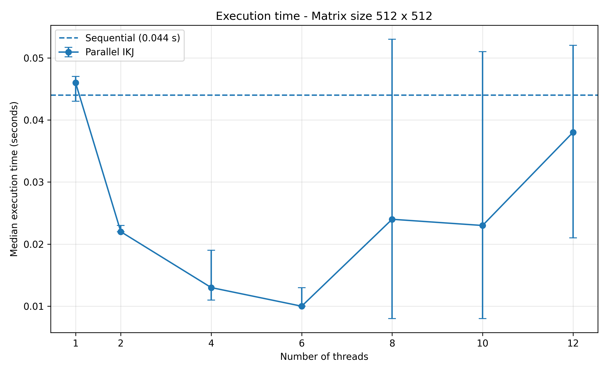
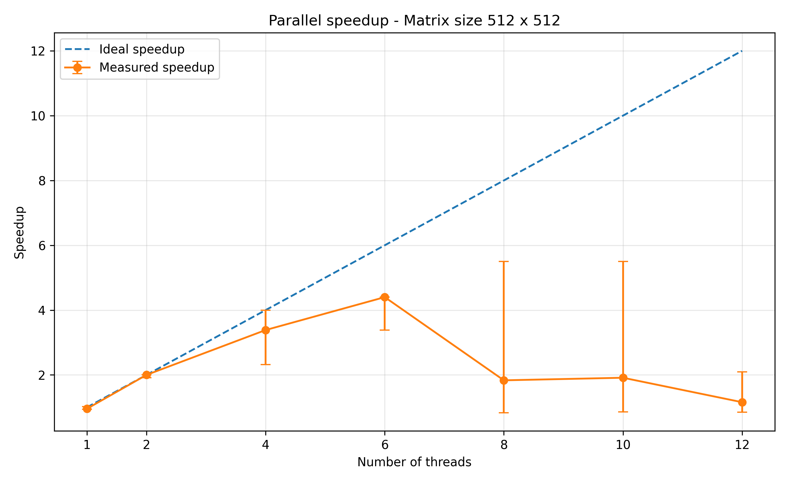
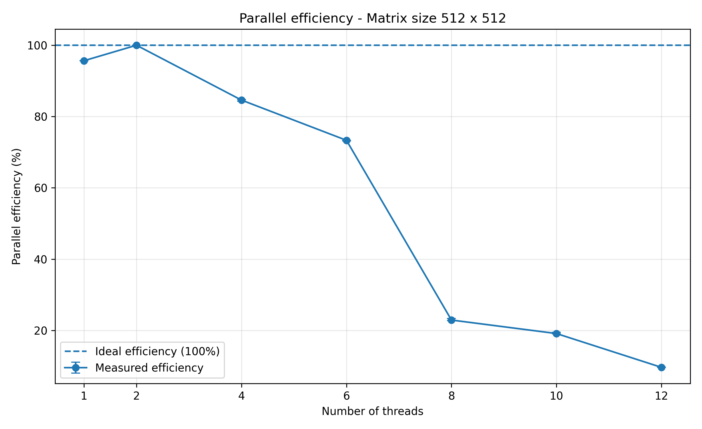
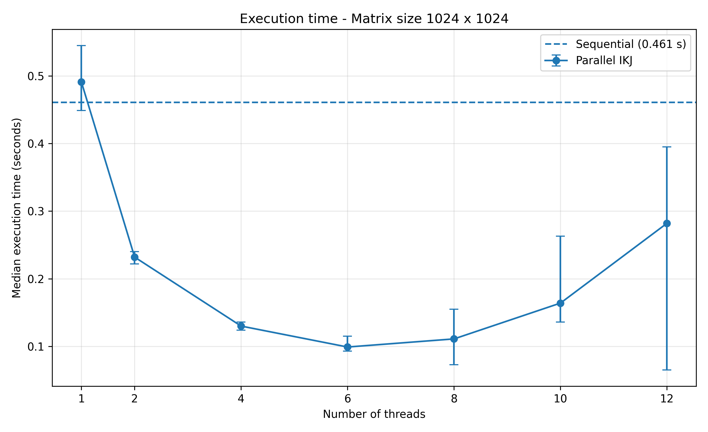
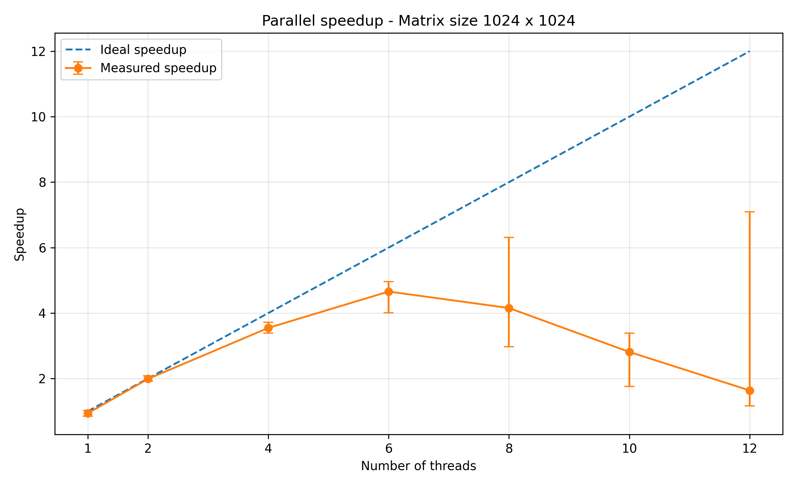
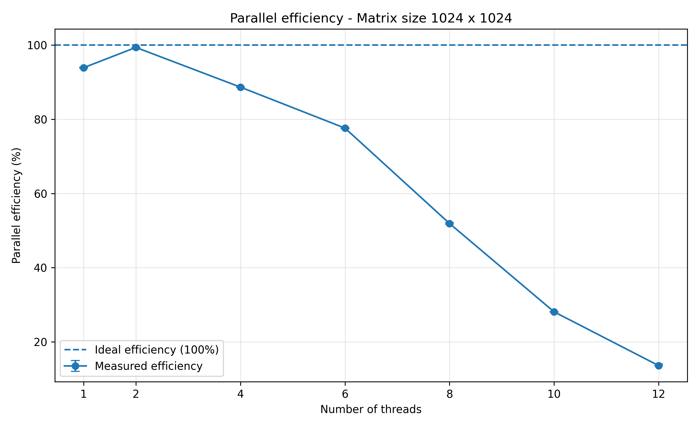
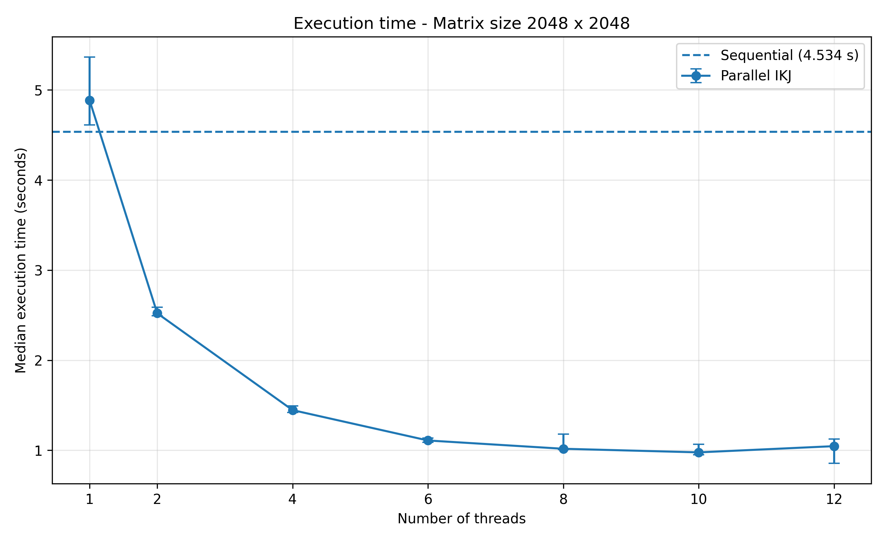
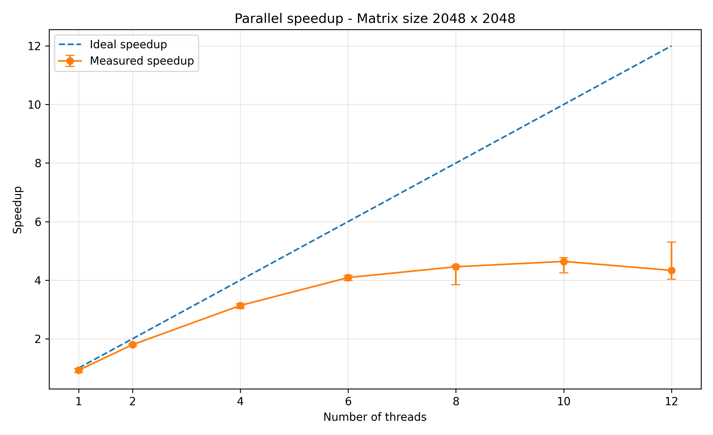
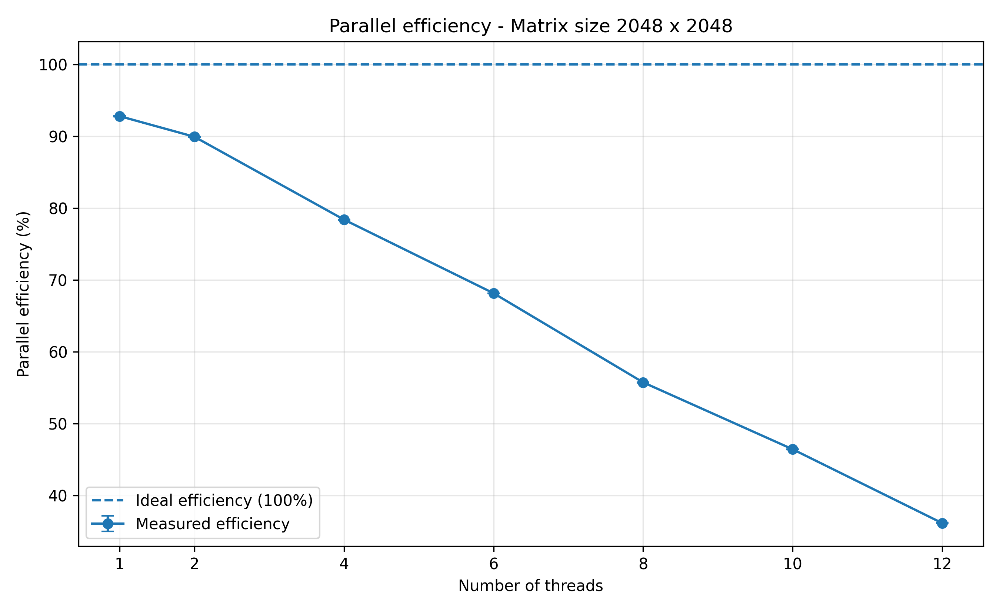

# Assignment 3: Parallel Matrix Multiplication

## 1. Introduction

The objective of this assignment is to analyse the performance improvements obtained by parallelising dense matrix multiplication using OpenMP.

The experiment compares a sequential implementation with a parallel implementation based on the same IKJ matrix multiplication algorithm. Different numbers of threads are evaluated to study execution time, speedup, parallel efficiency and memory consumption.

The implementation uses the C programming language and double-precision floating-point numbers (`double`).

## 2. Experimental environment

The experiments were conducted on the following hardware and software configuration:

| Component | Specification |
|---|---|
| Processor | 12th Gen Intel Core i5-12450H |
| Physical cores | 8 |
| Logical processors | 12 |
| RAM | 15.73 GB |
| Operating system | Windows |
| Compiler | GCC 16.2.0 (MSYS2 UCRT64) |
| Parallelisation library | OpenMP |
| Programming language | C |
| Numeric type | double |
| Matrix storage | Row-major |

The processor has a hybrid architecture consisting of performance cores (P-cores) and efficiency cores (E-cores). No manual CPU affinity was configured; thread scheduling was managed by Windows.

## 3. Implementation

### 3.1 Sequential implementation

The sequential implementation uses the IKJ loop ordering. This ordering iterates over the rows of the first matrix, then over the shared dimension, and finally over the columns of the second matrix.

### 3.2 Parallel implementation

The parallel version applies OpenMP to the outer loop over matrix rows using `#pragma omp parallel` and `#pragma omp for schedule(static)`.

Each thread processes different rows of the output matrix. The input matrices are read-only during multiplication, and each output row is assigned to a single thread. This avoids concurrent writes to the same output elements.

### 3.3 Correctness validation

The implementation includes identity-matrix and zero-matrix tests. Parallel results are also compared with the sequential reference using absolute and relative floating-point tolerances:

- Absolute tolerance: 1e-12.
- Relative tolerance: 1e-9.

All completed benchmark configurations passed validation.

## 4. Benchmark methodology

The experiments evaluate three matrix dimensions:

- 512 × 512
- 1024 × 1024
- 2048 × 2048

The same input matrices, numeric type and multiplication algorithm are used for sequential and parallel execution.

A fixed random seed (123456789) is used to make input generation reproducible.

For each configuration, one warm-up execution is performed, followed by seven measured repetitions. The median execution time is used for comparisons. Minimum, maximum and standard deviation are also recorded.

The output matrix is cleared outside the timed section, so the measured interval covers the multiplication operation itself.

The tested parallel thread counts are 1, 2, 4, 6, 8, 10 and 12.

## 5. Performance metrics

Speedup is calculated as:

S(p) = Tseq / Tp

Parallel efficiency is calculated as:

E(p) = S(p) / p

where Tseq is the sequential execution time, Tp is the parallel execution time using p threads.

Memory consumption is measured using the process peak working set reported by the Windows process memory API. This represents the maximum resident working set observed by the process, rather than the exact memory allocated exclusively to the matrices.

## 6. Results and Performance Analysis

### 6.1 Execution time

The following table presents the median execution times obtained for the sequential implementation and the fastest parallel configuration for each matrix size.

| Matrix size | Sequential time (s) | Best thread count | Parallel time (s) | Speedup |
|---|---:|---:|---:|---:|
| 512 × 512 | 0.044 | 6 | 0.010 | 4.400× |
| 1024 × 1024 | 0.461 | 6 | 0.099 | 4.657× |
| 2048 × 2048 | 4.534 | 10 | 0.977 | 4.641× |

The parallel implementation consistently outperformed the sequential baseline. The highest speedup was obtained with the 1024 × 1024 matrix, using six threads, with a speedup of approximately 4.66×.

For the largest completed matrix, 2048 × 2048, the best configuration used ten threads and achieved a speedup of approximately 4.64×.

### 6.2 Speedup and parallel efficiency

The best configurations achieved the following efficiencies:

| Matrix size | Best thread count | Speedup | Efficiency |
|---|---:|---:|---:|
| 512 × 512 | 6 | 4.400× | 73.33% |
| 1024 × 1024 | 6 | 4.657× | 77.61% |
| 2048 × 2048 | 10 | 4.641× | 46.41% |

Efficiency decreases for the largest matrix, even though its speedup remains high. This indicates that the additional threads do not contribute proportionally to performance.

The processor's hybrid architecture, memory subsystem, thread scheduling and parallel execution overhead may all influence scalability. The measurements do not isolate the contribution of each factor, so these should be considered possible explanations rather than individually proven causes.

### 6.3 Influence of thread count

The optimal thread count depends on matrix size.

For 512 × 512 and 1024 × 1024, six threads provided the shortest execution time. For 2048 × 2048, ten threads performed best.

Increasing the thread count beyond the optimal configuration did not consistently improve performance. In particular, the smaller matrices showed a substantial performance reduction with eight, ten and twelve threads.

This suggests that parallel overhead and scheduling costs become more significant when the workload is not large enough to benefit from additional threads.

The 2048 × 2048 matrix provides a larger workload, allowing ten threads to improve execution time compared with the six-thread configuration.

### 6.4 One-thread parallel overhead

The parallel implementation was also evaluated with one thread to measure the overhead introduced by the OpenMP implementation.

| Matrix size | Sequential time (s) | Parallel time with 1 thread (s) | Overhead |
|---|---:|---:|---:|
| 512 × 512 | 0.044 | 0.046 | 4.55% |
| 1024 × 1024 | 0.461 | 0.491 | 6.51% |
| 2048 × 2048 | 4.534 | 4.886 | 7.76% |

The parallel implementation was slower than the sequential implementation when using only one thread. This is expected because the OpenMP parallel region introduces additional runtime and thread-management overhead without providing parallel execution benefits.

### 6.5 Variability and measurement stability

Seven measured repetitions were performed for each configuration, after one warm-up execution. The median was selected as the main performance statistic because it is less sensitive to unusually high or low measurements than the arithmetic mean.

The minimum, maximum and standard deviation were also recorded in the raw CSV file.

The measurements show greater variability in some configurations with higher thread counts, particularly for smaller matrices. This suggests that system scheduling and runtime overhead can have a noticeable impact when the total computation time is relatively short.

For this reason, the median is used for the main comparisons, while variability is retained as supporting information.

### 6.6 Performance plots

The following plots provide a visual comparison of execution time, speedup and parallel efficiency for the three matrix sizes.

#### 512 × 512







#### 1024 × 1024







#### 2048 × 2048








## 7. Correctness, Resources and Limitations

### 7.1 Correctness and numerical accuracy

The implementation was tested using identity and zero matrices. These tests verified that the multiplication produces the expected results.

Additionally, the parallel implementation was compared against the sequential reference for every tested thread configuration.

Floating-point comparisons use a combined absolute and relative tolerance:

\[
|a-b| \leq 10^{-12} + 10^{-9}|a|
\]

The absolute tolerance is useful when reference values are close to zero, while the relative tolerance accounts for differences that scale with the magnitude of the result.

These tolerances are appropriate for checking small floating-point differences caused by numerical evaluation. All completed benchmark configurations passed validation.

### 7.2 Memory consumption

Peak process working set was measured using the Windows `GetProcessMemoryInfo` API and its `PeakWorkingSetSize` field.

| Matrix size | Peak working set |
|---|---:|
| 512 × 512 | 13.00 MiB |
| 1024 × 1024 | 37.01 MiB |
| 2048 × 2048 | 132.95 MiB |

This metric represents the maximum resident working set observed during the process execution. It includes more than the matrix arrays alone, such as executable code, runtime data and other process allocations.

Therefore, it should not be interpreted as the exact memory required by the three matrices.

### 7.3 Tested sizes and resource limitations

The experiment used the following progression:

- 128 × 128: small functional test. Execution times were too short for meaningful performance comparisons.
- 512 × 512: completed benchmark.
- 1024 × 1024: completed benchmark.
- 2048 × 2048: largest completed benchmark.
- 4096 × 4096: attempted, but interrupted manually because execution was taking too long.

The 4096 × 4096 experiment did not produce a completed benchmark result. Consequently, no execution time or performance measurement is reported for this size.

The largest successfully benchmarked matrix was 2048 × 2048. The largest attempted matrix was 4096 × 4096.

A limitation of the experimental procedure is that a formal maximum runtime and memory budget were not recorded before the large-size experiments. The decision to stop the 4096 × 4096 run was made based on practical execution time.

### 7.4 Other limitations

The experiments were conducted on a single computer, so the results may differ on processors with different architectures, memory bandwidth or scheduling behaviour.

CPU affinity was not manually configured. Windows controlled thread scheduling.

The measurements use process peak working set rather than per-allocation memory tracking. Furthermore, the study focuses on CPU parallelisation with OpenMP and does not include an independent SIMD vectorisation experiment. Vectorisation was an optional extension and was not required for this investigation.

## 8. Reproducibility

### 8.1 Dependencies

The project requires:

- Windows operating system.
- GCC 16.2.0 through MSYS2 UCRT64.
- OpenMP support through GCC's `-fopenmp` option.
- Python 3.14.2.
- Matplotlib 3.10.8.

### 8.2 Compilation

From the project root directory, configure the compiler path and compile the program using:

```powershell
$env:PATH = "C:\msys64\ucrt64\bin;$env:PATH"

gcc -O2 -std=c11 -Wall -Wextra -fopenmp .\src\c\parallel.c -o .\src\c\parallel.exe -lpsapi -lm
```

### 8.3 Running the benchmarks

Run the benchmark program by specifying the matrix dimension:

```powershell
.\src\c\parallel.exe 512
.\src\c\parallel.exe 1024
.\src\c\parallel.exe 2048
```

The program generates deterministic input matrices using a fixed seed. It performs one warm-up execution and seven measured repetitions for each configuration.

The measurements are saved in:

```text
results/assignment3/parallel_results.csv
```

The consolidated measurements used in this report are provided in:

```text
results/assignment3/parallel_results.csv
```

### 8.4 Generating tables and plots

The summary table can be regenerated with:

```powershell
python .\generate_summary.py
```

The plots can be regenerated with:

```powershell
python .\generate_plots.py
```

The scripts read the final CSV file and generate the summary table and performance plots without requiring the benchmarks to be executed again.

### 8.5 Project outputs

The main experimental outputs are:

- `src/c/parallel.c`: sequential and OpenMP implementations.
- `src/c/test_openmp.c`: OpenMP environment test.
- `results/assignment3/parallel_results.csv`: raw benchmark measurements.
- `results/assignment3/summary_results.csv`: summary results.
- `generate_summary.py`: summary generation script.
- `generate_plots.py`: plot generation script.
- `plots/`: execution time, speedup and efficiency figures.

The fixed random seed and documented commands make it possible to regenerate the input matrices and repeat the experiments under the same software configuration.


## 9. Conclusions

This assignment investigated the impact of thread count on shared-memory matrix multiplication using OpenMP.

The results demonstrate that parallel execution can significantly reduce computation time compared with the equivalent sequential implementation. The best configurations achieved speedups of 4.40×, 4.66× and 4.64× for matrix sizes of 512 × 512, 1024 × 1024 and 2048 × 2048, respectively.

The optimal thread count depended on the matrix size. Six threads performed best for the two smaller benchmark sizes, while ten threads achieved the shortest execution time for the largest completed matrix.

The experiments also showed that increasing the number of threads does not always improve performance. Thread-management overhead, scheduling and hardware characteristics can limit the benefits of parallel execution. The one-thread measurements confirmed that the OpenMP implementation introduces additional overhead compared with the sequential baseline.

Correctness was maintained across all completed configurations, and the parallel implementation passed the numerical validation tests. Memory consumption increased with matrix size, as expected, while the 2048 × 2048 matrix remained feasible within the available system resources.

Overall, the study shows that OpenMP can provide substantial performance improvements for dense matrix multiplication, but effective parallelisation requires selecting an appropriate thread count for the workload and hardware. The results also highlight the importance of measuring execution time, variability and memory consumption rather than relying on speedup alone.
