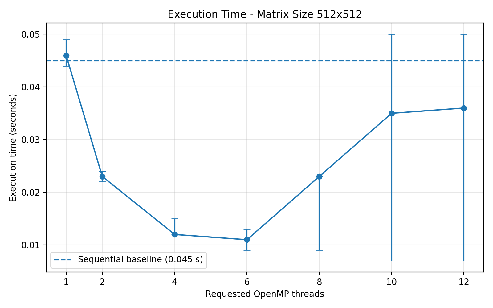
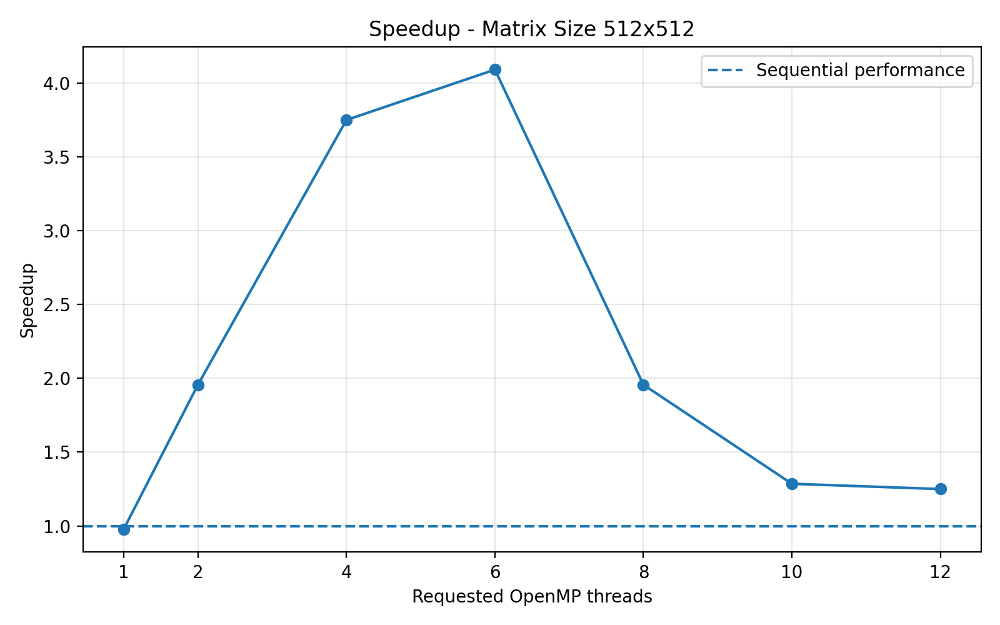
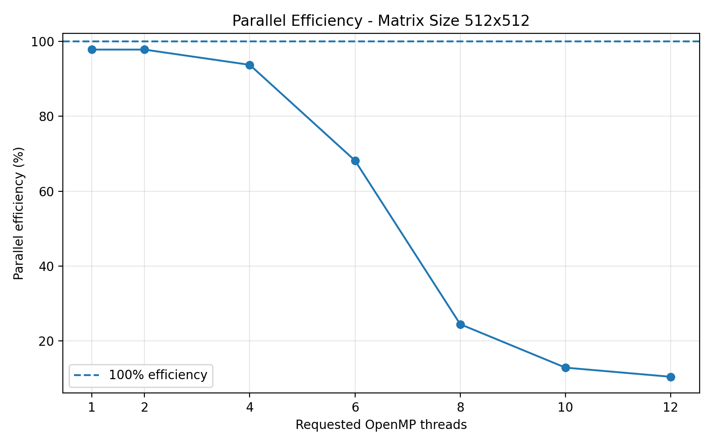
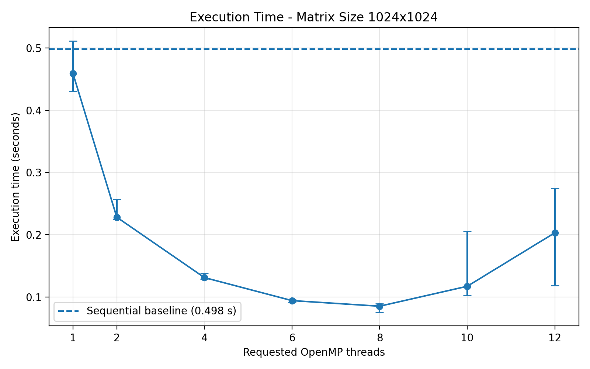
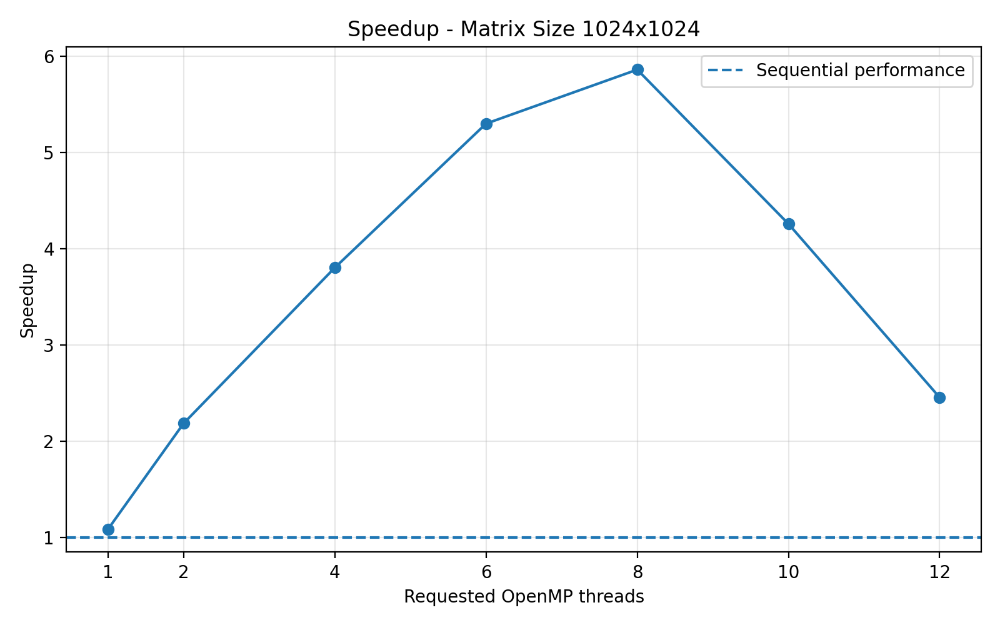
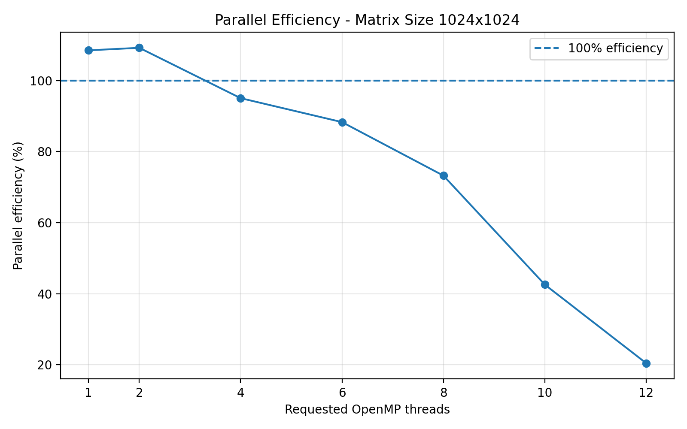
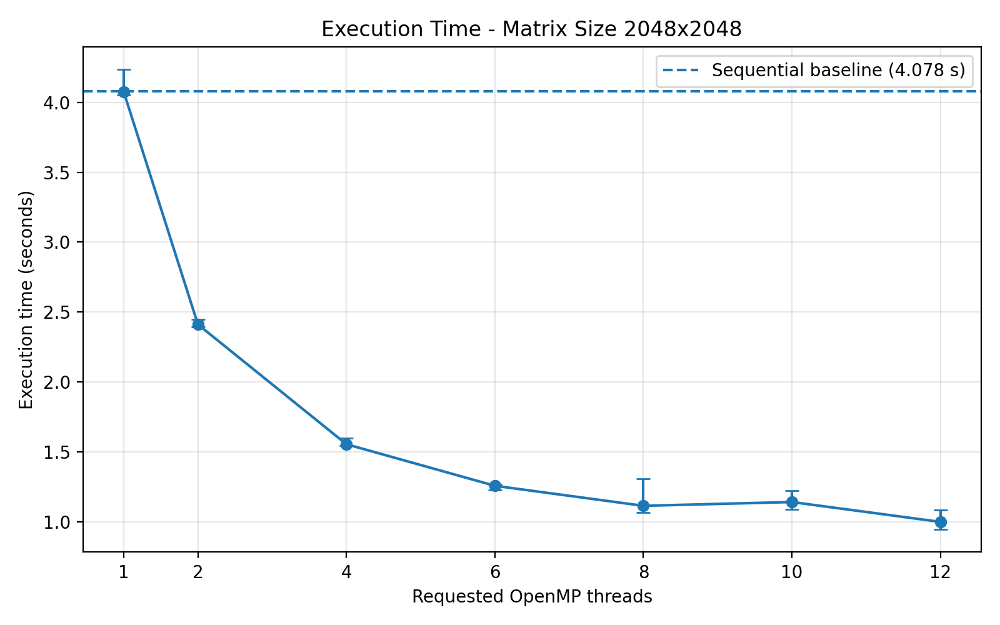
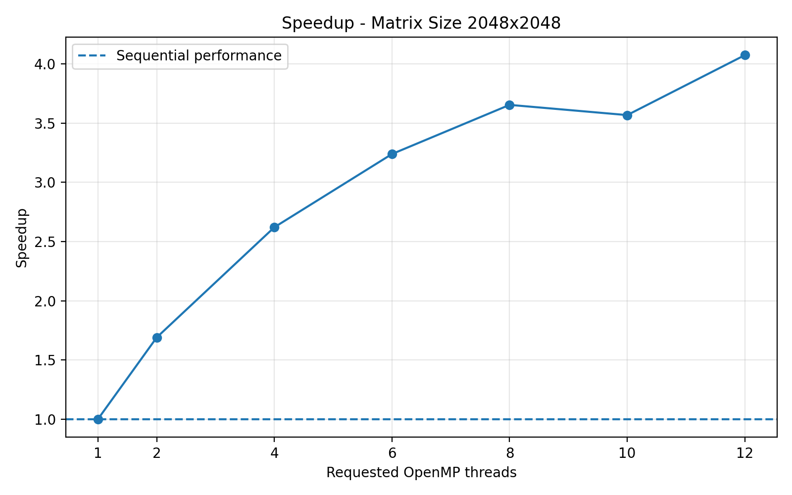
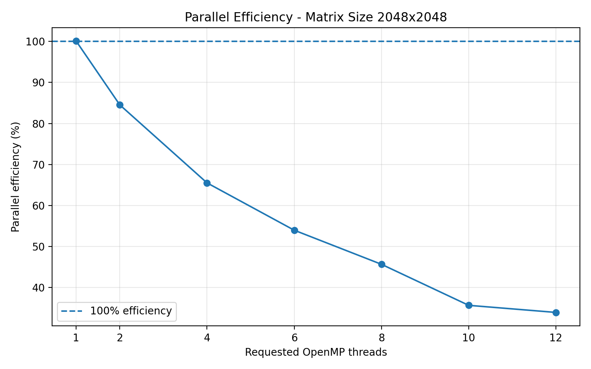

# Assignment 3: Parallel Matrix Multiplication

## 1. Introduction

The objective of this assignment is to investigate the performance improvements obtained by parallelising dense matrix multiplication using OpenMP.

The experiment compares a sequential implementation with a parallel implementation based on the same IKJ matrix multiplication algorithm. Different numbers of threads are evaluated to study execution time, speedup, parallel efficiency and memory consumption.

The implementation is written in C and uses double-precision floating-point numbers (`double`) and row-major matrix storage. An independent reference implementation using the IJK loop ordering is also included for correctness validation.

The main goal is to determine how thread count affects performance for different matrix sizes and to identify when parallel execution provides the greatest benefit.

## 2. Experimental Environment

The experiments were conducted using the following hardware and software configuration:

| Component | Specification |
|---|---|
| Processor | 12th Gen Intel Core i5-12450H |
| Physical cores | 8 |
| Logical processors | 12 |
| RAM | 15.73 GB |
| Operating system | Windows |
| Compiler | GCC 16.2.0 (MSYS2 UCRT64) |
| Parallelisation library | OpenMP |
| Programming language | C |
| Numeric type | double |
| Matrix storage | Row-major |
| Python | 3.14.2 |
| Matplotlib | 3.10.8 |

The processor has a hybrid architecture consisting of performance cores (P-cores) and efficiency cores (E-cores).

No manual CPU affinity was configured. The Windows operating system managed thread scheduling using the default process affinity.

## 3. Implementation

### 3.1 Sequential Implementation

The sequential implementation uses the IKJ loop ordering. This ordering iterates over the rows of the first matrix, then over the shared dimension, and finally over the columns of the second matrix.

This loop ordering allows consecutive elements of the output matrix and the corresponding row of the second input matrix to be accessed efficiently.

The sequential implementation provides the baseline against which the parallel version is evaluated.

### 3.2 Parallel Implementation

The parallel version applies OpenMP to the outer loop over matrix rows using:

```c
#pragma omp parallel
#pragma omp for schedule(static)
```

Each thread processes different rows of the output matrix. The input matrices are read-only during multiplication, and each output row is assigned to a single thread.

This design avoids concurrent writes to the same output elements and therefore prevents data races during matrix multiplication.

The static scheduling policy distributes loop iterations among threads before execution, reducing the need for dynamic scheduling decisions.

Dynamic team adjustment is disabled so that the requested thread configurations can be evaluated consistently.

### 3.3 Correctness Validation

The implementation includes several correctness tests.

First, a known 2 × 2 matrix multiplication is tested against an independently calculated expected result. An additional reference implementation using the IJK loop ordering is included. This reference implementation is independent of the IKJ algorithm used in the benchmarks and is used for correctness testing.

Both the sequential and parallel implementations are checked against the known result.

Additional tests verify multiplication by an identity matrix and by a zero matrix.

For benchmark validation, parallel results are compared with the sequential implementation using combined absolute and relative floating-point tolerances:

- Absolute tolerance: `1e-12`.
- Relative tolerance: `1e-9`.

All correctness tests and completed benchmark configurations passed validation.

## 4. Benchmark Methodology

### 4.1 Matrix Sizes

The controlled experiments evaluate three matrix dimensions:

- 512 × 512.
- 1024 × 1024.
- 2048 × 2048.

The same input matrices, numeric type and multiplication algorithm are used for sequential and parallel execution.

A fixed random seed (`123456789`) is used to make input generation reproducible.

A 128 × 128 matrix was also used for functional testing, but its execution time was too short for meaningful performance comparisons.

### 4.2 Repetitions and Timing

For each configuration, one warm-up execution is performed, followed by seven measured repetitions.

The median execution time is used for the main performance comparisons because it is less sensitive to unusually high or low measurements than the arithmetic mean.

Minimum, maximum and standard deviation are also recorded in the raw CSV file.

The output matrix is cleared outside the timed section, so the measured interval covers the multiplication operation itself.

### 4.3 Thread Configurations

The sequential implementation is used as the baseline.

The parallel implementation is evaluated using the following thread counts:

- 1 thread.
- 2 threads.
- 4 threads.
- 6 threads.
- 8 threads.
- 10 threads.
- 12 threads.

The processor has eight physical cores and twelve logical processors. Testing up to twelve threads makes it possible to examine the effect of using the available logical processing contexts, although the highest thread count is not necessarily the most efficient.

### 4.4 Memory Budget

The controlled experiment uses a theoretical matrix-allocation budget of 256 MiB.

Before allocating memory, the program estimates the storage required for the four matrix arrays used during execution: the two input matrices, the output matrix and the reference matrix.

The estimated requirement is calculated as:

\[
M = 4 \times n^2 \times \text{sizeof(double)}
\]

Configurations exceeding the 256 MiB matrix-allocation budget are rejected before allocation.

After the benchmark, the program measures the process peak working set using the Windows Process Status API and checks whether it exceeds the same 256 MiB budget.

This approach combines a pre-allocation check with a post-execution verification. It is not a continuously enforced operating-system memory limit.

## 5. Performance Metrics

### 5.1 Execution Time

Execution time measures the duration of the matrix multiplication operation.

The median of seven measured repetitions is used as the main performance statistic for each configuration.

### 5.2 Speedup

Speedup measures the performance improvement of the parallel implementation compared with the sequential baseline:

\[
S(p) = \frac{T_{seq}}{T_p}
\]


where:

- \(T_{seq}\) is the sequential execution time.
- \(T_p\) is the parallel execution time using \(p\) threads.

A speedup greater than 1 indicates that the parallel implementation is faster than the sequential implementation.

### 5.3 Parallel Efficiency

Parallel efficiency measures how effectively the available threads are used:

\[
E(p) = \frac{S(p)}{p}
\]

where \(S(p)\) is the speedup and \(p\) is the number of threads.

Efficiency is expressed as a percentage in the results.

### 5.4 Memory Consumption

Memory consumption is measured using the process peak working set reported by the Windows process memory API.

The measurement uses the `PeakWorkingSetSize` field obtained through `GetProcessMemoryInfo`.

This represents the maximum resident working set observed by the process, rather than the exact memory allocated exclusively to the matrices.

## 6. Results and Performance Analysis

### 6.1 Execution Time

The following table presents the median execution times obtained for the sequential implementation and the fastest parallel configuration for each matrix size.

| Matrix size | Sequential time (s) | Best thread count | Parallel time (s) | Speedup |
|---|---:|---:|---:|---:|
| 512 × 512 | 0.045 | 6 | 0.011 | 4.091× |
| 1024 × 1024 | 0.498 | 8 | 0.085 | 5.859× |
| 2048 × 2048 | 4.078 | 12 | 1.001 | 4.074× |

The parallel implementation outperformed the sequential baseline for all three matrix sizes.

The highest speedup was obtained with the 1024 × 1024 matrix, using eight threads, achieving approximately 5.86× the sequential performance.

For the largest completed matrix, 2048 × 2048, the best configuration used twelve threads and achieved a speedup of approximately 4.07×.

These results demonstrate that parallel execution can significantly reduce computation time, although the magnitude of the improvement depends on the matrix size and thread configuration.

### 6.2 Speedup and Parallel Efficiency

The best configurations achieved the following efficiencies:

| Matrix size | Best thread count | Speedup | Efficiency |
|---|---:|---:|---:|
| 512 × 512 | 6 | 4.091× | 68.18% |
| 1024 × 1024 | 8 | 5.859× | 73.24% |
| 2048 × 2048 | 12 | 4.074× | 33.95% |

The efficiency decreases for the largest matrix, even though parallel execution still provides a substantial speedup.

This indicates that the performance improvement does not scale proportionally with the number of threads. The additional threads do not contribute equally to reducing execution time.

The processor's hybrid architecture, memory subsystem, thread scheduling and parallel execution overhead may all influence scalability. The measurements do not isolate the contribution of each factor, so these should be considered possible explanations rather than individually proven causes.

### 6.3 Influence of Thread Count

The optimal thread count depends on matrix size.

For 512 × 512, six threads provided the shortest execution time. For 1024 × 1024, eight threads performed best, while twelve threads achieved the best result for 2048 × 2048.

Increasing the thread count beyond the optimal configuration did not consistently improve performance. This suggests that parallel overhead and scheduling costs can reduce the benefits of additional threads.

The larger matrix provides a greater computational workload, allowing more threads to contribute to reducing execution time. However, using all twelve logical processing contexts does not guarantee the highest parallel efficiency.

Although the processor has eight physical cores and twelve logical processors, the results show that the best configuration depends on the workload and processor architecture.

### 6.4 One-Thread Parallel Overhead

The parallel implementation was also evaluated with one thread to examine the difference between the OpenMP implementation and the sequential baseline.

| Matrix size | Sequential time (s) | Parallel time with 1 thread (s) | Difference |
|---|---:|---:|---:|
| 512 × 512 | 0.045 | 0.046 | +2.22% |
| 1024 × 1024 | 0.498 | 0.459 | −7.83% |
| 2048 × 2048 | 4.078 | 4.075 | −0.07% |

The percentage difference is calculated as:

\[
D = \frac{T_{parallel,1}-T_{seq}}{T_{seq}}\times 100
\]

A positive value indicates that the one-thread OpenMP implementation was slower than the sequential implementation. A negative value indicates that it was measured as faster.

The results show a small difference between the two implementations. For the 512 × 512 matrix, the OpenMP version was approximately 2.22% slower. For the other two sizes, the measured differences were very small or favoured the OpenMP version.

These small differences should not be interpreted as evidence that OpenMP reduces execution time when using one thread. They may be affected by measurement variability, operating-system scheduling and runtime conditions.

The results therefore suggest that one-thread OpenMP overhead is small relative to the computation time in these experiments, but its precise magnitude cannot be isolated reliably from these measurements.

### 6.5 Variability and Measurement Stability

Seven measured repetitions were performed for each configuration, after one warm-up execution.

The median was selected as the main performance statistic because it is less sensitive to unusually high or low measurements than the arithmetic mean.

The minimum, maximum and standard deviation were also recorded in the raw CSV file.

Some configurations showed greater variability, particularly when using higher thread counts with smaller matrices. This suggests that operating-system scheduling and runtime overhead can have a noticeable impact when the total computation time is relatively short.

For this reason, the median is used for the main comparisons, while the variability measurements are retained as supporting information.

### 6.6 Performance Plots

The following plots provide a visual comparison of execution time, speedup and parallel efficiency for the three matrix sizes.

#### 512 × 512







#### 1024 × 1024







#### 2048 × 2048







## 7. Correctness, Resources and Limitations

### 7.1 Correctness and Numerical Accuracy

Correctness was evaluated using three basic tests: a known matrix multiplication, multiplication by an identity matrix and multiplication by a zero matrix.

For the known-result test, the following matrices were used:

\[
A=\begin{bmatrix}1&2\\3&4\end{bmatrix},
\qquad
B=\begin{bmatrix}5&6\\7&8\end{bmatrix}
\]

The expected result is:

\[
C=\begin{bmatrix}19&22\\43&50\end{bmatrix}
\]

An independent IJK reference implementation calculates this result and is used to verify both the sequential and parallel implementations.

The identity-matrix test verifies that multiplying a matrix by the identity matrix preserves its values. The zero-matrix test verifies that multiplying by a zero matrix produces an output matrix containing only zeros.

For the benchmark configurations, the parallel results are also compared against the sequential implementation using a combined absolute and relative tolerance:

\[
|a-b| \leq 10^{-12} + 10^{-9}|a|
\]

The absolute tolerance is useful when reference values are close to zero, while the relative tolerance accounts for differences that scale with the magnitude of the result.

All basic correctness tests and completed benchmark configurations passed validation.

### 7.2 Memory Consumption

Peak process working set was measured using the Windows `GetProcessMemoryInfo` API and its `PeakWorkingSetSize` field.

| Matrix size | Peak working set |
|---|---:|
| 512 × 512 | 13.00 MiB |
| 1024 × 1024 | 36.99 MiB |
| 2048 × 2048 | 132.96 MiB |

This metric represents the maximum resident working set observed during process execution. It includes more than the matrix arrays alone, such as executable code, runtime data and other process allocations.

Therefore, it should not be interpreted as the exact memory required by the matrix arrays.

All three completed benchmark sizes passed the program's post-execution memory check against the 256 MiB budget.

### 7.3 Tested Sizes and Resource Limitations

The experiment used the following progression:

- 128 × 128: small functional test. Execution times were too short for meaningful performance comparisons.
- 512 × 512: completed benchmark.
- 1024 × 1024: completed benchmark.
- 2048 × 2048: largest completed benchmark.
- 4096 × 4096: rejected by the controlled experiment's memory pre-allocation check.

The 4096 × 4096 configuration requires approximately 512 MiB for the four matrix arrays. This exceeds the declared 256 MiB matrix-allocation budget, so the controlled experiment rejects it before allocating the matrices.

An earlier exploratory attempt at this size was also stopped manually because execution was taking too long. No completed benchmark result was obtained for 4096 × 4096, and consequently no execution time or performance measurement is reported for this size.

The largest successfully benchmarked matrix was 2048 × 2048. The largest evaluated dimension was 4096 × 4096, but it was not completed.

The 256 MiB budget applies to the theoretical matrix allocations and is checked again against the process peak working set after execution. It is not a continuously enforced operating-system memory limit.

### 7.4 Other Limitations

The experiments were conducted on a single computer, so the results may differ on processors with different architectures, memory bandwidth or scheduling behaviour.

CPU affinity was not manually configured. Windows controlled thread scheduling using the default process affinity.

The measurements use process peak working set rather than per-allocation memory tracking.

Furthermore, the study focuses on CPU parallelisation with OpenMP and does not include an independent SIMD vectorisation experiment. Vectorisation was an optional extension and was not required for this investigation.

## 8. Reproducibility

### 8.1 Dependencies

The project requires:

- Windows operating system.
- GCC 16.2.0 through MSYS2 UCRT64.
- OpenMP support through GCC's `-fopenmp` option.
- Python 3.14.2.
- Matplotlib 3.10.8.

Matplotlib can be installed using:

```powershell
python -m pip install matplotlib==3.10.8
```

### 8.2 Compilation

From the project root directory, configure the compiler path and compile the program using:

```powershell
$env:PATH = "C:\msys64\ucrt64\bin;$env:PATH"

gcc -O2 -std=c11 -Wall -Wextra -fopenmp .\src\c\parallel.c -o .\src\c\parallel.exe -lpsapi -lm
```

### 8.3 Running the Benchmarks

Run the benchmark program by specifying the matrix dimension:

```powershell
.\src\c\parallel.exe 512
.\src\c\parallel.exe 1024
.\src\c\parallel.exe 2048
```

The program generates deterministic input matrices using a fixed seed. It performs one warm-up execution and seven measured repetitions for each configuration.

The measurements are saved in:

```text
results/assignment3/parallel_results_limited.csv
```

The consolidated summary is saved in:

```text
results/assignment3/summary_results_limited.csv
```

The benchmark program appends measurements to the raw CSV file. Therefore, previous measurements should be backed up or the output file should be prepared before starting a new complete benchmark campaign, to avoid mixing repeated runs unintentionally.

### 8.4 Generating Tables and Plots

The summary table can be regenerated with:

```powershell
python .\generate_summary.py
```

The plots can be regenerated with:

```powershell
python .\generate_plots.py
```

The scripts read the raw CSV file and generate the summary table and performance plots without requiring the benchmarks to be executed again.

The generated plots are stored in:

```text
plots/limited/
```

### 8.5 Project Outputs

The main experimental outputs are:

- `src/c/parallel.c`: sequential and OpenMP implementations, including correctness tests.
- `src/c/test_openmp.c`: OpenMP environment test.
- `results/assignment3/parallel_results_limited.csv`: raw benchmark measurements.
- `results/assignment3/summary_results_limited.csv`: summary results.
- `generate_summary.py`: summary generation script.
- `generate_plots.py`: plot generation script.
- `plots/limited/`: execution time, speedup and efficiency figures.
- `README.md`: project overview and execution instructions.

The fixed random seed and documented commands make it possible to regenerate the input matrices and repeat the experiments under the same software configuration.

## 9. Conclusions

This assignment investigated the impact of thread count on shared-memory matrix multiplication using OpenMP.

The results demonstrate that parallel execution can significantly reduce computation time compared with the equivalent sequential implementation. The best configurations achieved speedups of approximately 4.09×, 5.86× and 4.07× for matrix sizes of 512 × 512, 1024 × 1024 and 2048 × 2048, respectively.

The optimal thread count depended on the matrix size. Six threads performed best for the smallest benchmark, eight threads for the intermediate size and twelve threads for the largest completed matrix.

The experiments also showed that increasing the number of threads does not always improve performance. Thread-management overhead, scheduling and hardware characteristics can limit the benefits of parallel execution. The one-thread measurements showed only small differences from the sequential baseline, which were not large enough to isolate OpenMP overhead reliably.

Correctness was maintained across all completed configurations. The implementation passed the known-result, identity-matrix and zero-matrix tests, and the parallel implementation passed numerical validation against the sequential implementation.

Memory consumption increased with matrix size, as expected. The largest completed benchmark, 2048 × 2048, remained within the declared 256 MiB budget. The 4096 × 4096 configuration was rejected by the pre-allocation memory check because its theoretical matrix allocation exceeded the budget.

Overall, the study shows that OpenMP can provide substantial performance improvements for dense matrix multiplication, but effective parallelisation requires selecting an appropriate thread count for the workload and hardware. The results also highlight the importance of measuring execution time, variability and memory consumption rather than relying on speedup alone.